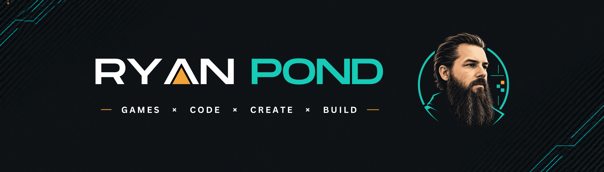

# Ryan Pond

I'm an indie game developer building games in **Godot** and documenting the process as I go. I share what works, what breaks, and what I learn along the way.

## Currently Building

### SIGNAL (working title)

A top-down tactical stealth game being developed for **Godot Wild Jam #98**.

You play an anthropomorphic frog operative using stealth, sound, patrol manipulation, takedowns, and tactical information to complete objectives and get out alive.

Current focus: refining the core stealth loop, encounter design, and mission structure.

### NEXT LEVEL — Annual Planning Digital Board Game

An internal digital board-game project I'm building for my company's Annual Planning meeting.

It's an experimental MVP exploring how a real-world planning process can be turned into an interactive game experience.

## On Hold

### DOOM DELIVERY 1.0

A momentum-driven bicycle courier game originally created for Godot Wild Jam and planned as a complete standalone game.

Development is currently paused while I work on other projects, but **DOOM DELIVERY is not cancelled**.

[Follow development](https://ryanpond.com/games/doom-delivery/) · [Play the jam prototype](https://ryanpond.itch.io/doom-delivery/)

## What I'm Into

Game development, programming, game jams, small prototypes, and technical experiments. Godot is my main tool for turning ideas into playable games.

## Find Me

[Website](https://ryanpond.com) · [Email](mailto:hello@ryanpond.com) · [itch.io](https://ryanpond.itch.io/) · [YouTube](https://www.youtube.com/@ryanpond) · [X](https://x.com/RyanPondBuilds)
